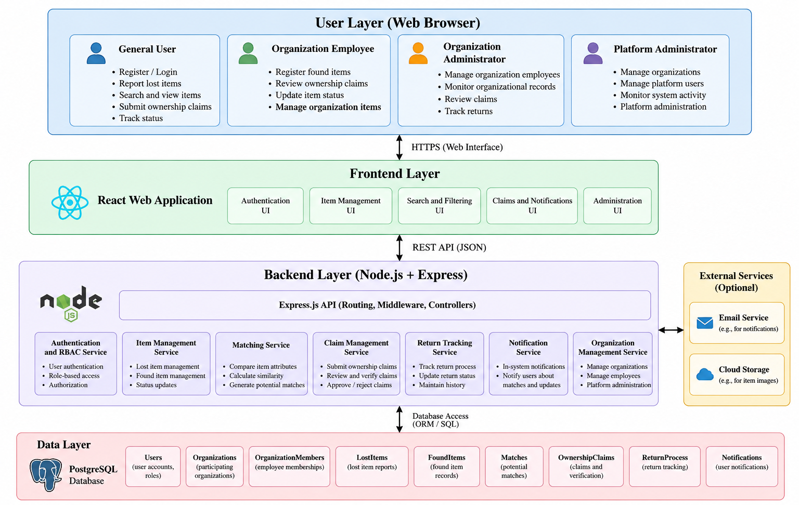
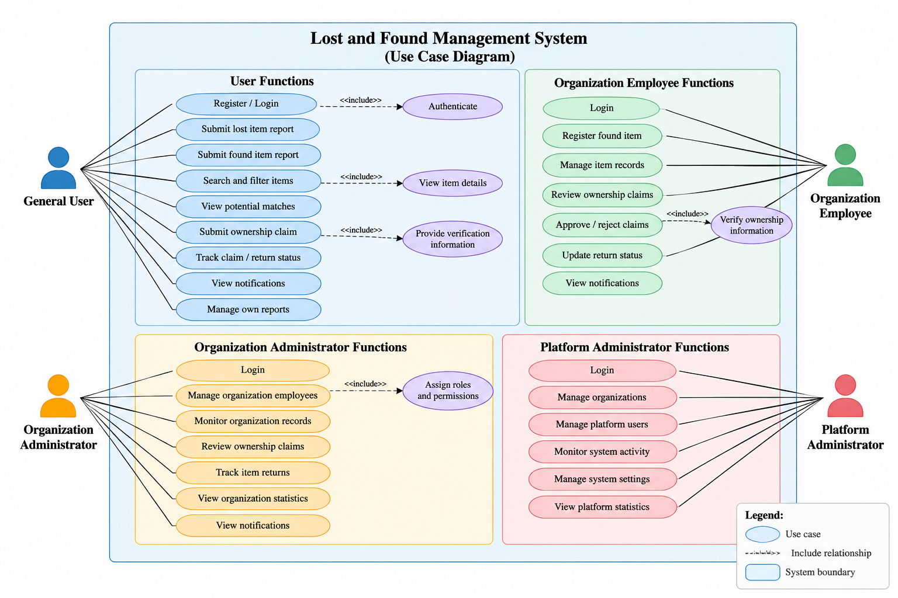
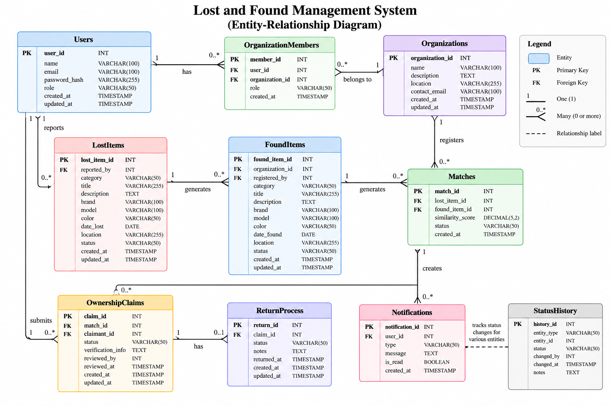

# 7. System Architecture and Diagrams

## 7.1. Introduction

This section presents the proposed architecture of the Multi-Organization Lost and Found Management System. The architecture is based on the functional and non-functional requirements defined in the previous section and reflects the selected React and Node.js with Express technology stack.

The system follows a web-based client-server architecture. The React frontend provides interfaces for users and organization representatives, while the Node.js and Express backend processes requests, applies business rules, performs authorization checks, and communicates with the database.

Three diagrams are used to describe the system from different perspectives: a System Architecture Diagram, a Use Case Diagram, and an Entity-Relationship Diagram.

## 7.2. System Architecture

The proposed system uses a layered architecture consisting of the user layer, frontend layer, backend application layer, and data layer.

**Figure 1. System Architecture Diagram**

The user layer consists of the four roles defined in the requirements: General User, Organization Employee, Organization Administrator, and Platform Administrator.

The frontend layer is implemented using React. It provides the web interfaces required for authentication, lost and found item reporting, searching, potential match review, ownership claims, notifications, return status tracking, and administrative operations.

The frontend communicates with the backend through REST API requests. The backend is implemented using Node.js with Express and contains the main application logic.

The main backend responsibilities include:

- Authentication and role-based access control;
- Lost and found item management;
- Search and filtering;
- Automated item matching;
- Ownership claim and verification management;
- Return process tracking;
- Notification management;
- Organization and employee management.

The data layer stores persistent information required by the application, including users, organizations, organization memberships, lost items, found items, potential matches, ownership claims, return processes, notifications, and status history.

External services, such as email delivery or cloud-based file storage, may be integrated if required during implementation. These integrations are considered optional and are not required for the initial prototype.

## 7.3. Main Architecture Components

The architecture separates system responsibilities into several components.

### 7.3.1. React Frontend

The React frontend is responsible for presenting information and collecting user input. Different interface functionality will be available depending on the authenticated user's role.

Reusable components can be used for item cards, report forms, search results, status indicators, notifications, ownership claims, and administrative interfaces.

### 7.3.2. Node.js and Express Backend

The backend provides REST API endpoints and implements the main business logic of the application.

Express will be used to organize API routes and middleware. Backend services will process requests from the frontend, validate submitted data, apply authorization rules, interact with stored data, and return appropriate responses.

### 7.3.3. Authentication and Role-Based Access Control

Authentication identifies registered users, while role-based access control determines which protected operations they are allowed to perform.

The authorization mechanism will distinguish between General Users, Organization Employees, Organization Administrators, and Platform Administrators.

Organization-level authorization is also required to prevent employees from performing restricted administrative operations on records belonging to organizations for which they are not authorized.

### 7.3.4. Item Management

The item management component is responsible for lost and found reports. It processes report creation, updates, retrieval, search, filtering, and status changes.

Found items managed by participating organizations are associated with the corresponding organization.

### 7.3.5. Matching Service

The matching component identifies potential relationships between lost and found item reports.

The initial implementation will use selected structured attributes, such as category, color, brand, model, location, and date. A rule-based or similarity-scoring mechanism can assign a similarity value to compatible records.

A generated match is treated only as a potential relationship and does not establish ownership.

### 7.3.6. Ownership Verification and Return Tracking

The ownership claim component allows users to submit supporting information for potentially matching found items.

Authorized organization employees review ownership claims and determine whether they should be approved or rejected. Verification information that should not be publicly visible is kept separate from public item information.

After an ownership claim has been approved, the return process component tracks the administrative progress of returning the item to the verified owner.

## 7.4. Use Case Diagram

The Use Case Diagram represents the main interactions between system actors and the proposed platform.

**Figure 2. Use Case Diagram**

The **General User** can register and authenticate, submit lost and found reports, search and filter items, view potential matches, submit ownership claims, provide verification information, track claim and return statuses, manage personal reports, and view notifications.

The **Organization Employee** can authenticate, register found items, manage authorized item records, review ownership claims, verify ownership information, approve or reject claims, update return statuses, and view relevant notifications.

The **Organization Administrator** is responsible for organization-level administration. This role can manage organization employees, monitor organizational records, review relevant ownership claims, monitor return processes, and access organization-level information permitted by the system.

The **Platform Administrator** performs platform-level administrative operations, including managing participating organizations and controlling platform-level administrative access.

The use case model demonstrates the separation between ordinary user functionality, organization-specific operations, and platform-level administration.

## 7.5. Entity-Relationship Diagram

The Entity-Relationship Diagram presents the proposed logical data structure of the system and the relationships between its main entities.

**Figure 3. Entity-Relationship Diagram**

The proposed data model contains the following principal entities:

**Users** stores registered user account information. A user can create lost item reports, submit ownership claims, receive notifications, and, where authorized, belong to an organization.

**Organizations** stores information about participating organizations. Organizational records are separated to support the multi-organization structure of the platform.

**OrganizationMembers** connects users with organizations and stores their organization-specific roles or permissions.

**LostItems** stores lost item reports submitted by users, including item characteristics, loss date, approximate location, status, and related information.

**FoundItems** stores found item records. Organizationally managed found items are associated with the organization responsible for the record and the employee who registered it.

**Matches** represents potential relationships between lost and found reports. It can store the corresponding lost item, found item, similarity score, and match status.

**OwnershipClaims** stores claims submitted by users for potentially matching found items. It contains the claimant, related match, verification information, review status, and review information.

**ReturnProcess** represents the administrative return workflow associated with an approved ownership claim.

**Notifications** stores messages generated for users when relevant events occur, such as potential matches or claim status changes.

**StatusHistory** can be used to record important status transitions for selected entities, supporting traceability of significant workflow changes.

## 7.6. Main Entity Relationships

The proposed model contains several important relationships.

A user can submit multiple lost item reports and ownership claims. A user may also be associated with an organization through an organization membership record.

An organization can contain multiple authorized members and manage multiple found item records.

A lost item report and a found item report can participate in potential matches. Each match represents a possible correspondence identified by the matching mechanism.

A potential match can result in one or more ownership claims depending on the implemented business rules. An approved claim may lead to a return process.

Users can receive multiple notifications during these workflows. Status changes for relevant entities may also be recorded to provide an activity history.

The final database schema may be refined during implementation while preserving the relationships and access restrictions required by the system specification.

## 7.7. Architectural Decisions

Several architectural decisions were made based on the current project scope.

First, the system uses a client-server architecture with a separate React frontend and Node.js with Express backend. This separates interface responsibilities from server-side business logic and allows communication through REST APIs.

Second, automated matching is implemented as a separate logical responsibility. This makes it possible to modify or extend matching rules without redesigning unrelated functionality.

Third, automated matching and ownership verification are separated. A similarity score or potential match cannot independently authorize the return of an item. Ownership must be reviewed through the claim verification workflow.

Fourth, the system uses role-based and organization-aware authorization. This is necessary because the platform supports several independent organizations while providing selected shared functionality to users.

Finally, the architecture is designed to be modular. Authentication, item management, matching, claims, return tracking, notifications, and organization management are treated as separate responsibilities even if they are initially deployed as parts of one backend application.

## 7.8. Conclusion

This section presented the proposed architecture of the Multi-Organization Lost and Found Management System.

The System Architecture Diagram described the interaction between users, the React frontend, the Node.js and Express backend, application services, and the data layer.

The Use Case Diagram illustrated the responsibilities and interactions of General Users, Organization Employees, Organization Administrators, and Platform Administrators.

The Entity-Relationship Diagram defined the principal data entities required to support user accounts, organizations, lost and found reports, automated matching, ownership claims, return tracking, notifications, and status history.

Together, these architectural models provide the foundation for the subsequent interface design and implementation of the system.
