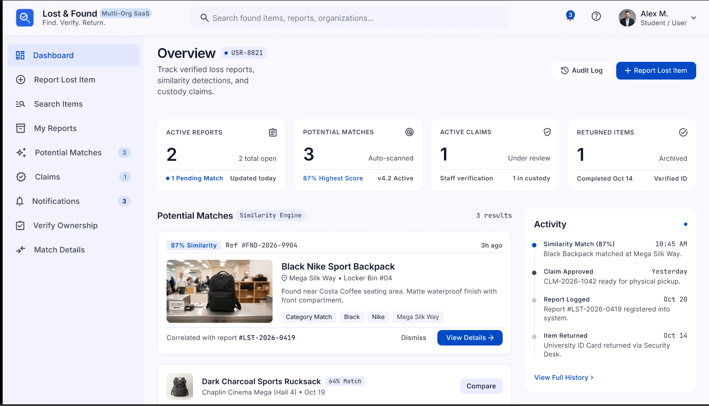
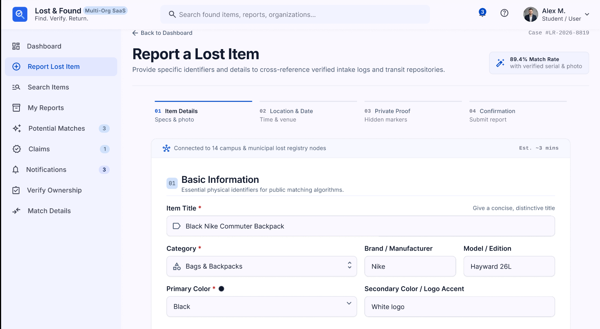
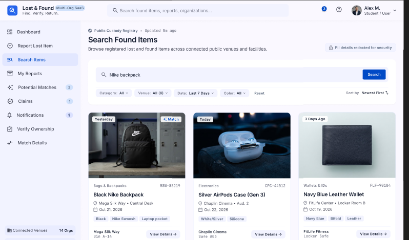

# 8. User Interface Prototype

## 8.1. Introduction

An initial user interface prototype was developed to visualize the proposed design and main user interactions of the Multi-Organization Lost and Found Management System.

The prototype represents an early design stage of the system and is intended to validate the overall interface structure, navigation approach, information hierarchy, and presentation of the main system functions before full implementation.

At the current stage, the prototype focuses primarily on the General User interface. Additional screens, detailed interactions, and organization-specific interfaces will be refined during the subsequent development stages.

## 8.2. Prototype Design

The prototype was designed in Figma using a consistent web-based interface style. The design follows a dashboard-oriented structure with a sidebar for navigation and a main content area for system functionality.

The interface uses consistent typography, form elements, cards, status indicators, navigation components, and visual hierarchy across the designed screens.

The current prototype includes the following main screens:

- User Dashboard;
- Report Lost Item;
- Search Found Items.

These screens represent several of the primary interactions defined in the system requirements.

## 8.3. User Dashboard

**Figure 4. User Dashboard Prototype**

The User Dashboard provides an overview of the user's activity within the system. It presents information related to active reports, potential matches, ownership claims, returned items, recent activity, and participating organizations.

The sidebar provides access to the main functional areas of the system, including lost item reporting, item search, personal reports, potential matches, claims, and notifications.

The dashboard is designed to provide users with a centralized view of the current state of their lost and found processes.

## 8.4. Lost Item Reporting Interface

**Figure 5. Lost Item Reporting Prototype**

The Report Lost Item screen provides a structured form for submitting information about a lost item.

The interface collects characteristics that can later be used by the automated matching mechanism, including item category, brand, model, color, date, location, description, and photographs.

The prototype also demonstrates the separation of public item information from additional identifying information that may be used during ownership verification.

## 8.5. Found Item Search Interface

**Figure 6. Found Item Search Prototype**

The Search Found Items screen demonstrates how users can browse found items registered within the platform.

The interface provides search and filtering functionality and presents found items using structured cards containing relevant information such as item characteristics, location, date, and the organization responsible for the item.

Sensitive ownership verification information is not displayed as part of the public search interface.

## 8.6. Prototype Status and Future Refinement

The current Figma prototype should be considered an initial design prototype rather than the final implemented user interface.

Its purpose at this stage is to establish the visual direction of the application and demonstrate how the main functional requirements can be represented through the user interface.

During subsequent development stages, the prototype will be extended with additional interfaces for potential matches, ownership claims, claim status tracking, return process tracking, notifications, and organization management.

Interactive navigation and detailed user flows may also be expanded as the interface and implementation are refined.

Therefore, the current prototype provides a design foundation that can be iteratively updated based on implementation requirements, usability considerations, and project feedback.

## 8.7. Conclusion

The initial interface prototype demonstrates the proposed visual structure of the Multi-Organization Lost and Found Management System and covers several core General User operations.

The prototype establishes a consistent design approach for the User Dashboard, lost item reporting, and found item search functionality. It also provides a foundation for the development of additional user and organization interfaces during the implementation phase.
